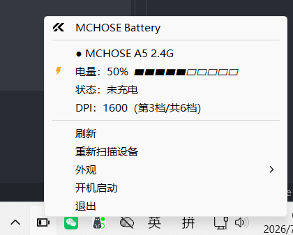
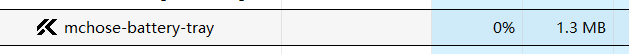

# MCHOSE Battery Tray

Windows 托盘小工具：读取 **MCHOSE / 迈从** 鼠标电量与充电状态（部分型号含 DPI）。

纯 Rust，体积极小，内存占用超低，不依赖官方新驱动。



## 这是做什么的

- 常驻系统托盘，一眼看到电量
- 右键菜单：设备、电量、充电状态、DPI（若可读）、刷新 / 重扫
- 通过 HID 协议直连鼠标，兼容官方已弃更的老型号（如 A5 Pro 系）

## 资源占用

空闲时内存约 **1.3 MB**，CPU 接近 0%。



## 支持与验证

协议已按旧驱动 + 官方网页源码实现。**已验证** 表示有真机确认；其余欢迎社区用 `--scan` 帮忙验证。

### 已验证

| 型号 | 协议 | 说明 |
|------|------|------|
| **G3 A** | Gmouse | 网页 `/gmouse` 协议，真机通过 |
| **A5 Pro Max** | A5/AX5 | 旧驱动协议（VID `0x2023`），真机通过 |
| **K5 Ultra 典藏版** | K5 | 新一代 Nordic 协议（PID `0x1018`），真机通过，含 DPI |

### 协议已实现 · 待验证

| 型号范围 | 协议 | 来源 |
|----------|------|------|
| A5 Pro、AX5 Pro / Pro Max 等旧驱动系 | A5/AX5 | 旧版 `DriverCore` 反编译 |
| G3 V2、G3 V2 Pro、A7e、G7 / G7 Pro 等 | Gmouse | [mchose.com.cn/gmouse](https://www.mchose.com.cn/gmouse) |
| 旧 A7 | A7 | 公开项目逻辑移植 |
| K7 Ultra、M7 / L7 系列、G7 系列（HUB）、G3 Ultra、A5 Ultra / V2 Ultra / V3、AX5 V2、A7 V2+ 等 | Hub | 官方主站 HUB 网页协议 |
| K5 Pro / Ultra / 典藏版、K5 V2、A5 V3、A7 V3、K7 V2 等新一代 Nordic 型号 | K5 | HUB `newMouse` 协议（report `0x4D` / cmd `0x0900`） |

更细的 VID/PID 与命令说明见 [`docs/web_device_table.md`](docs/web_device_table.md)。

> 已实现 ≠ 每台真机测过。若你的型号可读或读失败，欢迎提 Issue 附上 `--scan` 输出。

## 使用

**要求：** Windows。使用旧 A5 系时请先退出官方 `DriverCore`，避免占用 HID 接口。

```powershell
# 仅扫描 / 探测协议（推荐先跑这个）
cargo run -- --scan

# 启动托盘
cargo run

# 发布构建
cargo build --release
```

产物：`target/release/mchose-battery-tray.exe`。

## 欢迎验证

如果你有列表中的型号：

1. `cargo run -- --scan`
2. 把终端输出（VID/PID、协议名、电量是否成功）开 Issue 或 PR
3. 可选：说明有线 / 2.4G、是否充电

也欢迎补充协议、修 bug、改进托盘 UI。

## 致谢

- 公开项目 *MaiCong-A7-Check-Battery* （旧 A7 协议思路）
- MCHOSE 网页 HUB / gmouse 前端中的协议逻辑（用于移植，非官方附属软件）

本项目与 MCHOSE / 迈从官方无隶属关系。

## 许可证

[MIT](LICENSE)
